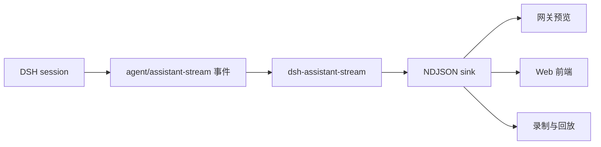

<div align="center">
  <h1>dsh-assistant-stream</h1>
  <p><strong>把 DeepSeek Harness 的流式输出导出成 NDJSON。</strong></p>
  <p>为网关、桌面端与调试工具提供可实时消费的 assistant 流。</p>

  <p>
    
    
    
    <a href="https://awesome-dsh-plugin.com/p/ninetyhe-90/dsh-assistant-stream/"></a>
    <a href="LICENSE"></a>
  </p>

  <p>简体中文 · <a href="README_EN.md">English</a></p>
</div>

> [!NOTE]
> 这是一个 DSH bundle。`dsh plugin add` 即可安装，插件行由随包的 `cordis.patch.yml` 注入，无需手写 profile 配置。

## 为什么做这个插件

DeepSeek Harness 的 assistant 输出是事件流：文本与推理增量、块结束、消息提交、轮次边界、工具调用围栏。宿主进程内可以直接订阅，但外部进程（网关、Web 前端、录制工具）拿不到稳定的消费格式。

这个插件把这条事件流翻译成一行一个 JSON 的 NDJSON，写到你指定的 sink。外部进程只需要按行读取，就能实时重建一次回答的完整过程，并保证提交顺序与围栏顺序一致。



## 核心能力

| 能力 | 使用体验 |
| --- | --- |
| 统一帧格式 | 每行一个 JSON 对象，固定前缀 `ASSISTANT_STREAM_V1 `，便于逐行切分 |
| 完整时序 | `start`、`delta`、`block`、`commit`、`end` 覆盖一次尝试的完整生命周期 |
| 轮次边界 | `turn-start` / `turn-end` 由会话事件驱动，外部可以按轮次聚合 |
| 顺序围栏 | 工具调用、工具结果与用量提交各有一个递增 fence，便于对齐 |
| 子代理隔离 | 子会话（`parentSession` 或 `origin: subagent`）不会写入 sink |
| 自定义输出 | 默认写 stderr，也可以通过 `write` 交给内存、文件或 socket |

## 帧类型

| `op` | 含义 |
| --- | --- |
| `turn-start` / `turn-end` | 轮次开始与结束，仅导出根会话 |
| `start` | 一次模型尝试开始，`seq` 归零 |
| `delta` | `text` 或 `reasoning` 的增量文本 |
| `block` | 一个文本或推理块结束 |
| `commit` | 本次尝试提交的 assistant 消息 |
| `event-fence` | 工具调用、工具结果、用量提交的顺序标记 |
| `end` | 本次尝试结束，携带 `outcome` |

## 安装

已收录于 [awesome-dsh-plugin](https://awesome-dsh-plugin.com/p/ninetyhe-90/dsh-assistant-stream/)。推荐从 GitHub 安装：

```sh
dsh plugin --profile <name> add github:ninetyhe-90/dsh-assistant-stream
```

首次从 Git 源安装时，pnpm 会拦下仓库的构建脚本，命令以 `ERR_PNPM_GIT_DEP_PREPARE_NOT_ALLOWED` 或 `ERR_PNPM_IGNORED_BUILDS` 中止。dsh 会打印需要放行的密钥，把它加到该 profile 的 `pnpm-workspace.yaml` 的 `allowBuilds` 下，再重跑同一条命令即可。放行构建等于信任该来源，需要固定版本时用 `github:ninetyhe-90/dsh-assistant-stream#<commit-sha>`。

本地开发时直接在仓库根目录安装：

```sh
dsh plugin --profile <name> add /path/to/dsh-assistant-stream
```

> 尚未发布到 npm。`dsh plugin --profile <name> add dsh-assistant-stream` 目前会 404，等发布后可用。

安装完成后在会话里随便发一句话，stderr 出现以 `ASSISTANT_STREAM_V1 ` 开头的行即表示插件已生效。

## 配置

| 字段 | 类型 | 默认 | 说明 |
| --- | --- | --- | --- |
| `readTurnId` | `() => string \| undefined` | 读取 `DSH_TURN_ID` | 返回当前轮次的请求 id |
| `write` | `(line: string) => void` | 写 stderr | 接收每一行 NDJSON |

`readTurnId` 缺失或返回空时，`requestId` 回落到 `session.id`，不会中断会话。

```yaml
- insert:
    - id: assistant-stream
      name: dsh-assistant-stream
```

## 兼容性

- Node.js 20.11+
- DeepSeek Harness 0.2.x：依赖 `agent/assistant-stream` 与 `session/event` 事件
- 旧版本缺少 `session.requestContext` 时，插件会跳过用量围栏，其余帧不受影响

## 项目结构

```text
src/assistant-stream.mjs    插件入口与帧导出逻辑
test/assistant-stream.test.mjs  行为测试（node:test）
cordis.patch.yml            bundle 安装时注入的插件行
```

## 开发与验证

```sh
npm test
npm run check
```

## 路线图

- [x] 文本与推理增量导出
- [x] 轮次边界与工具围栏
- [x] 子代理隔离
- [x] bundle 安装形式
- [ ] npm 发布
- [ ] 浏览器端消费示例

## 许可证

MIT
