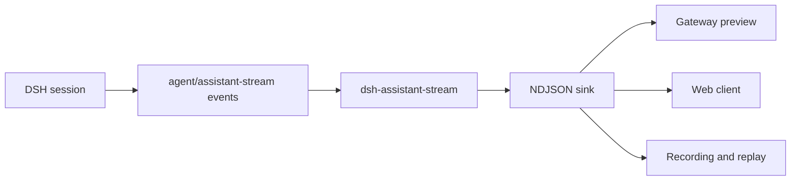

<div align="center">
  <h1>dsh-assistant-stream</h1>
  <p><strong>Export DeepSeek Harness assistant streaming frames as NDJSON.</strong></p>
  <p>Give gateways, desktop shells, and debug tools a stable stream to consume in real time.</p>

  <p>
    
    
    
    <a href="https://awesome-dsh-plugin.com/p/ninetyhe-90/dsh-assistant-stream/"></a>
    <a href="LICENSE"></a>
  </p>

  <p><a href="README.md">简体中文</a> · English</p>
</div>

> [!NOTE]
> This is a DSH bundle. `dsh plugin add` installs it, and `cordis.patch.yml` inserts the plugin row automatically.

## Why this plugin

DeepSeek Harness emits assistant output as an event stream: text and reasoning deltas, block ends,
message commits, turn boundaries, and tool fences. The host can subscribe directly, but external
processes cannot consume it in a stable format.

This plugin turns the stream into one JSON object per line. A consumer reads lines, rebuilds the
whole answer in order, and keeps commits and fences aligned.



## Capabilities

| Capability | Behaviour |
| --- | --- |
| One frame format | One JSON object per line, prefixed with `ASSISTANT_STREAM_V1 ` |
| Full lifecycle | `start`, `delta`, `block`, `commit`, and `end` cover one attempt |
| Turn boundaries | `turn-start` and `turn-end` let consumers group by turn |
| Ordering fences | Tool calls, tool results, and usage commits each carry an increasing fence |
| Subagent isolation | Subagent sessions are never exported |
| Custom sink | stderr by default; pass `write` to capture elsewhere |

## Frame types

| `op` | Meaning |
| --- | --- |
| `turn-start` / `turn-end` | Turn boundaries for the root session |
| `start` | A model attempt began; `seq` restarts at 0 |
| `delta` | Incremental `text` or `reasoning` |
| `block` | A completed text or reasoning block |
| `commit` | The committed assistant message for this attempt |
| `event-fence` | Ordering marker for tool calls, results, and usage |
| `end` | The attempt finished, with its outcome |

## Install

```sh
dsh plugin --profile <name> add dsh-assistant-stream
dsh plugin --profile <name> add /path/to/dsh-assistant-stream
dsh plugin --profile <name> add github:ninetyhe-90/dsh-assistant-stream
```

## Configuration

| Field | Type | Default | Description |
| --- | --- | --- | --- |
| `readTurnId` | `() => string \| undefined` | `DSH_TURN_ID` | Request id for the current turn |
| `write` | `(line: string) => void` | stderr | Receives each NDJSON line |

When `readTurnId` is missing or returns empty, `requestId` falls back to `session.id`.

## Compatibility

- Node.js 20.11+
- DeepSeek Harness 0.2.x (`agent/assistant-stream`, `session/event`)
- Builds without `session.requestContext` skip the usage fence; other frames are unaffected

## Layout

```text
src/assistant-stream.mjs        plugin entry and frame export
test/assistant-stream.test.mjs  behaviour tests (node:test)
cordis.patch.yml                bundle layer
```

## Development

```sh
npm test
npm run check
```

## Roadmap

- [x] Text and reasoning deltas
- [x] Turn boundaries and tool fences
- [x] Subagent isolation
- [x] Bundle packaging
- [ ] npm release
- [ ] Browser consumer example

## License

MIT
